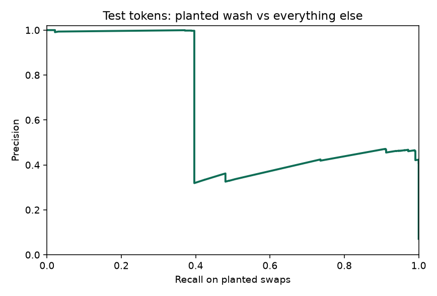
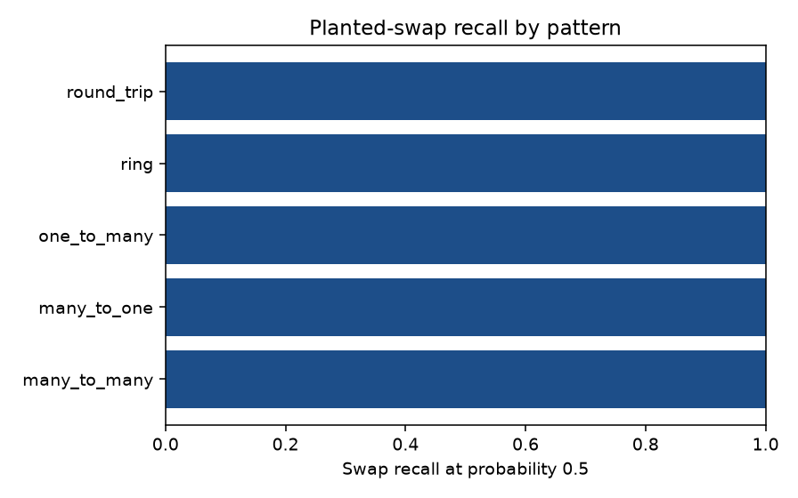
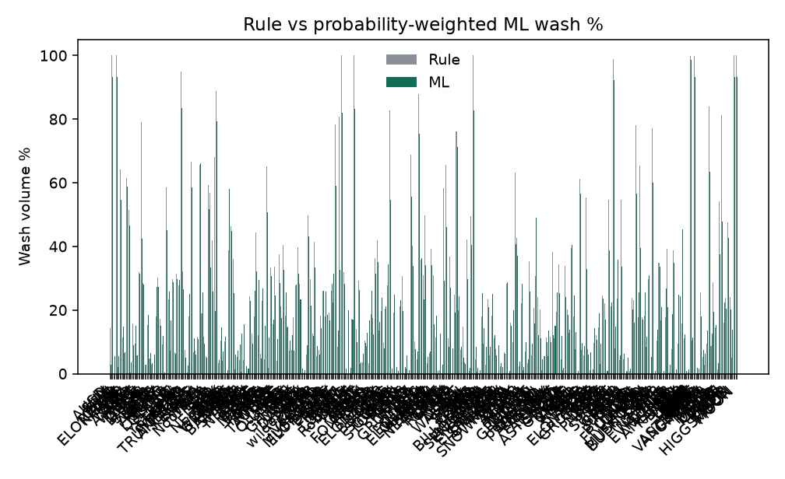

# Evaluation: wash models

Milestone 2 of the Uniswap Wash Detector (ECM3401, University of Exeter). There is no public ground truth, so the supervised numbers below are recall and precision on wash groups planted into real pool history, with train and test split by token.

## Dataset

Window: the last 7 day(s) ending when each token was fetched, Ethereum mainnet, public RPC, no API key. Fetch s is the cold public-RPC scrape when a successful row exists in fetch-log.txt beside the database; otherwise it is the time spent loading that token during this training run.

| Symbol | Token | Real swaps | Real transfers | Fetch s | Split |
|---|---|---:|---:|---:|---|
| BEAM | `0x62d0a8458ed7719fdaf978fe5929c6d342b0bfce` | 7041 | 11469 | 208.9 | calib |
| 1INCH | `0x111111111117dc0aa78b770fa6a738034120c302` | 1626 | 69746 | 785.3 | test |
| 4 | `0x6fd643f4afcdb76e125815af4426da9380189219` | 667 | 1062 | 122.3 | test |
| AIB | `0xb3a0f70c913aa04404bd177be9e20b47613830b6` | 634 | 1214 | 129.7 | test |
| AMERICA | `0x267f827aa257de8eacec3c07dfa491c2e52b2a7d` | 40 | 55 | 46.7 | test |
| AMP | `0xff20817765cb7f73d4bde2e66e067e58d11095c2` | 1866 | 3225 | 203.0 | test |
| ANT | `0xf0f95e5cf887df25e461e344721fd0ef4fa4bf51` | 86 | 3596 | 132.0 | test |
| AP | `0xe60e9bd04ccc0a394f1fdf29874e35a773cb07f4` | 274 | 304 | 159.3 | test |
| ARROW | `0xae37649927605b730a93ff05ad310c88a46f901e` | 73 | 76 | 44.6 | test |
| ASTEROID | `0xf280b16ef293d8e534e370794ef26bf312694126` | 1617 | 2133 | 129.6 | test |
| AUDIO | `0x18aaa7115705e8be94bffebde57af9bfc265b998` | 241 | 1333 | 119.1 | test |
| BAT | `0x0d8775f648430679a709e98d2b0cb6250d2887ef` | 4967 | 7962 | 181.2 | test |
| BNB | `0xb8c77482e45f1f44de1745f52c74426c631bdd52` | 862 | 2170 | 72.5 | test |
| BOOE | `0x289ff00235d2b98b0145ff5d4435d3e92f9540a6` | 187 | 403 | 64.5 | test |
| BOX | `0x32b77729cd87f1ef2bea4c650c16f89f08472c69` | 92 | 164 | 96.5 | test |
| BST | `0x509a38b7a1cc0dcd83aa9d06214663d9ec7c7f4a` | 210 | 259 | 70.5 | test |
| CAW | `0xf3b9569f82b18aef890de263b84189bd33ebe452` | 976 | 1203 | 136.5 | test |
| CELL | `0x26c8afbbfe1ebaca03c2bb082e69d0476bffe099` | 424 | 582 | 126.8 | test |
| COTI | `0xddb3422497e61e13543bea06989c0789117555c5` | 1282 | 2964 | 151.6 | test |
| CULT | `0xf0f9d895aca5c8678f706fb8216fa22957685a13` | 74 | 227 | 51.2 | test |
| DG | `0x53c8395465a84955c95159814461466053dedede` | 13 | 23 | 106.1 | test |
| DPI | `0x1494ca1f11d487c2bbe4543e90080aeba4ba3c2b` | 180 | 420 | 83.5 | test |
| DSync | `0xf94e7d0710709388bce3161c32b4eea56d3f91cc` | 505 | 1150 | 90.6 | test |
| ELON2028 | `0x5deef9a61128f713df881e76d0b91ee8f8e21602` | 243 | 691 | 22.1 | test |
| ELON2028 | `0x9c8e5b5c767b20c8e0bfafd4ce6354636e8fe839` | 212 | 218 | 31.9 | test |
| ETH | `0x3e6dd720f83aa5316b3c7a81a4112bd72cd20c07` | 1637 | 3743 | 97.2 | test |
| FEY | `0xe8e06a5613dc86d459bc8fb989e173bb8b256072` | 101 | 143 | 56.7 | test |
| FWA | `0xa0df17b5ac76ababa36e1450e2cbcd18a620c845` | 4968 | 13276 | 223.3 | test |
| GHX | `0x728f30fa2f100742c7949d1961804fa8e0b1387d` | 962 | 2209 | 131.6 | test |
| GINNAN | `0x375e104af98872e5b4fe951919e504a47db1757c` | 559 | 195 | 79.7 | test |
| GROKLET | `0xbe7e21746fad3f6f83e22d02910bec250a493feb` | 781 | 1058 | 143.9 | test |
| GRT | `0xc944e90c64b2c07662a292be6244bdf05cda44a7` | 1770 | 5771 | 357.3 | test |
| GTC | `0xde30da39c46104798bb5aa3fe8b9e0e1f348163f` | 11405 | 19891 | 373.5 | test |
| Hoodi | `0x239fa2f30a1a4ff66f04410b8b9b5e6c1585feaa` | 17 | 19 | 44.0 | test |
| JOE | `0x76e222b07c53d28b89b0bac18602810fc22b49a8` | 193 | 342 | 95.0 | test |
| KEKIUS | `0x26e550ac11b26f78a04489d5f20f24e3559f7dd9` | 641 | 1110 | 55.0 | test |
| KISHU | `0xa2b4c0af19cc16a6cfacce81f192b024d625817d` | 610 | 1133 | 64.0 | test |
| LDO | `0x5a98fcbea516cf06857215779fd812ca3bef1b32` | 5897 | 11817 | 162.3 | test |
| LINK | `0x514910771af9ca656af840dff83e8264ecf986ca` | 15623 | 62536 | 231.9 | test |
| LMEOW | `0x1ae7e1d0ce06364ced9ad58225a1705b3e5db92b` | 137 | 241 | 79.0 | test |
| LNQ | `0xd4f4d0a10bcae123bb6655e8fe93a30d01eebd04` | 223 | 433 | 61.1 | test |
| LUMINA | `0xa727ad163a58098716fbce31752e75f18613c8f8` | 1853 | 2951 | 116.7 | test |
| LUSH | `0xec9333e7dadeebf82d290d6cb12e66cc30ce46b0` | 24 | 56 | 52.3 | test |
| MASK | `0x69af81e73a73b40adf4f3d4223cd9b1ece623074` | 1837 | 4297 | 144.4 | test |
| MER | `0x904652d502ed1e2ae0182d156c8bf01f76db8924` | 261 | 248918 | 279.7 | test |
| MTX | `0x000025b3816630ad283267d4eb3a5fc8b0200000` | 445 | 1516 | 94.0 | test |
| NEAR | `0x85f17cf997934a597031b2e18a9ab6ebd4b9f6a4` | 5160 | 7918 | 185.1 | test |
| Noorung | `0x2a49e6146fb9aad418943f77c79da6c371514889` | 297 | 439 | 137.0 | test |
| OMIKAMI | `0x9e18d5bab2fa94a6a95f509ecb38f8f68322abd3` | 380 | 702 | 120.1 | test |
| OVER | `0x743f1b0291a490b924ffcfe8508af2a9ac1a6552` | 70 | 57186 | 320.8 | test |
| PAC | `0x4c44a8b7823b80161eb5e6d80c014024752607f2` | 61 | 55 | 190.0 | test |
| PGP | `0xeb4364498135ef0f5b20617a0e94ed07a74fdd7e` | 1 | 53 | 34.5 | test |
| PNKSTR | `0xc50673edb3a7b94e8cad8a7d4e0cd68864e33edf` | 1428 | 1269 | 82.9 | test |
| POO | `0xbd820be85944606e2d0abb3ea2aa167f6e2849b2` | 14 | 21 | 77.9 | test |
| Particle | `0x5c79313d62830dc71ae28b0c0282c4cff59d3658` | 75 | 80 | 91.7 | test |
| Quamfy | `0x4ec1cc161c6c06151ee1564ef9365819ee28d0b7` | 77 | 82 | 54.0 | test |
| REM | `0x29b20d2d80fc4ab4cf2c9bd38d69195b130be28c` | 77 | 81 | 31.6 | test |
| REQ | `0x8f8221afbb33998d8584a2b05749ba73c37a938a` | 257 | 706 | 132.6 | test |
| Robotaxi | `0x64ec41c325f61e245cecd7e2941c9f572d0803ec` | 1215 | 1741 | 81.1 | test |
| SENDOVER | `0x9925805b9b0dda34418798ccf95bcff5633f9176` | 1044 | 1648 | 112.7 | test |
| SERV | `0x40e3d1a4b2c47d9aa61261f5606136ef73e28042` | 550 | 1286 | 108.6 | test |
| SHIRO | `0xb0ac2b5a73da0e67a8e5489ba922b3f8d582e058` | 229 | 691 | 66.1 | test |
| SHRUB | `0x3b991130eae3cca364406d718da22fa1c3e7c256` | 317 | 275 | 83.8 | test |
| SPDG | `0xf46ccb9e08fb7e32eed560c87d5e583a59a43420` | 122 | 241 | 32.5 | test |
| STORJ | `0xb64ef51c888972c908cfacf59b47c1afbc0ab8ac` | 612 | 1483 | 87.7 | test |
| SUN | `0x0000429d40ffcc7d524deedeecae0feedbff0000` | 3 | 7 | 62.2 | test |
| SXSI | `0x08d2439829470bdafe3fbcea97402a0242facb44` | 2386 | 3211 | 160.5 | test |
| TAOBOT | `0x49fb8ad7578148e17c3ef0c344ce23a66ed372c4` | 168 | 420 | 41.8 | test |
| TRX | `0x50327c6c5a14dcade707abad2e27eb517df87ab5` | 792 | 1318 | 129.3 | test |
| Tether | `0x616abeac77a10070f7acee323b04fd5e5ff86bbe` | 18 | 137 | 15.8 | test |
| USDT | `0x672848c237698a44378d64c98280275cefae61b2` | 9271 | 18221 | 290.8 | test |
| VANCE | `0x9b465aab9e8f325418f222c37de474b1bd38ded2` | 39 | 80 | 95.6 | test |
| VANCE2028 | `0xf2b36ba4a4438516b808049d5ae013ec5ddd849a` | 50 | 60 | 136.6 | test |
| WDOGE | `0x35a532d376ffd9a705d0bb319532837337a398e7` | 1338 | 670 | 237.1 | test |
| WOO | `0x4691937a7508860f876c9c0a2a617e7d9e945d4b` | 3299 | 3836 | 170.7 | test |
| WXMR | `0x465e07d6028830124be2e4aa551fbe12805db0f5` | 254 | 442 | 56.5 | test |
| X | `0xabec00542d141bddf58649bfe860c6449807237c` | 35 | 138 | 43.9 | test |
| XAUt | `0x68749665ff8d2d112fa859aa293f07a622782f38` | 10180 | 29371 | 441.5 | test |
| XRP | `0xba5f1f2061528b3224868ac9afffc6e55b5abd34` | 13 | 15 | 55.5 | test |
| Yee | `0x9ac9468e7e3e1d194080827226b45d0b892c77fd` | 876 | 1480 | 162.4 | test |
| ZAMA | `0xa12cc123ba206d4031d1c7f6223d1c2ec249f4f3` | 11527 | 17163 | 288.9 | test |
| ZGAP | `0x58d9a3efb0dfab2ab008bfa60c1db382f92b644a` | 818 | 829 | 82.6 | test |
| ZIG | `0xb2617246d0c6c0087f18703d576831899ca94f01` | 1196 | 2574 | 146.2 | test |
| dmt-nat | `0x249130f5e2dd4cf278180c0df8273f3592ad1247` | 755 | 961 | 115.2 | test |
| puppies | `0xcf91b70017eabde82c9671e30e5502d312ea6eb2` | 823 | 1776 | 95.7 | test |
| tap | `0x5e7f6e008c6d9d7ad4c7eb75bd4ce62864cc7454` | 363 | 426 | 82.8 | test |
| wNXM | `0x0d438f3b5175bebc262bf23753c1e53d03432bde` | 523 | 613 | 196.4 | test |
| wTAO | `0x77e06c9eccf2e797fd462a92b6d7642ef85b0a44` | 5106 | 8780 | 177.4 | test |
| wildebeest | `0x57737ded3870e43fed7d80d31e0ced3d5fb0cccc` | 519 | 692 | 54.8 | test |
| wojak | `0x8de39b057cc6522230ab19c0205080a8663331ef` | 892 | 1745 | 152.4 | test |
| zc | `0xd305785d98f72868d047ce8d4cbaec6dcb6acccc` | 1421 | 1998 | 165.5 | test |
| $PAAL | `0x14fee680690900ba0cccfc76ad70fd1b95d10e16` | 362 | 878 | 59.5 | train |
| 4 | `0x2d5947a2e22e7946d0f83dbc8fae83d6218b29b6` | 249 | 255 | 86.1 | train |
| 4 | `0x313e6ef1cb8ec32867382386f9669ce6351e6196` | 164 | 166 | 20.6 | train |
| 4 | `0x789462ad49a3eb919a37010396911591c78762e3` | 2833 | 3740 | 80.7 | train |
| 4 | `0xa53b76628b05f287e18b3d435f05cc0f93e7b8ad` | 113 | 118 | 36.5 | train |
| 7AΩ∞ | `0x622b6330f226bf08427dcad49c9ea9694604bf2d` | 25 | 36 | 89.4 | train |
| AAVE | `0x7fc66500c84a76ad7e9c93437bfc5ac33e2ddae9` | 20505 | 45309 | 256.3 | train |
| ADI | `0x8b1484d57abbe239bb280661377363b03c89caea` | 9189 | 15622 | 254.9 | train |
| ADR | `0x159457b4b3aff10f7f00158b3f1fd54bce200ca4` | 90 | 95 | 111.4 | train |
| ADR | `0xfe1ca8cd80a448e28d1e9c9d159060786d485512` | 56 | 59 | 39.5 | train |
| ADX | `0xade00c28244d5ce17d72e40330b1c318cd12b7c3` | 371 | 714 | 97.5 | train |
| AGL | `0x63401cdd577478f9389a1683e866a937f072d1c2` | 444 | 984 | 116.9 | train |
| ALT | `0x8457ca5040ad67fdebbcc8edce889a335bc0fbfb` | 2641 | 15066 | 290.8 | train |
| AMERICA | `0xe6f2e92dfb7ac55a13b2056fc0b37dbc9fcee733` | 7 | 8 | 151.7 | train |
| AMPL | `0xd46ba6d942050d489dbd938a2c909a5d5039a161` | 201 | 342 | 95.7 | train |
| ANDY | `0x68bbed6a47194eff1cf514b50ea91895597fc91e` | 936 | 1150 | 92.0 | train |
| APE | `0x4d224452801aced8b2f0aebe155379bb5d594381` | 1426 | 6842 | 546.0 | train |
| API3 | `0x0b38210ea11411557c13457d4da7dc6ea731b88a` | 661 | 1528 | 88.4 | train |
| APU | `0x594daad7d77592a2b97b725a7ad59d7e188b5bfa` | 489 | 1123 | 78.6 | train |
| ASE | `0x041ff0e49f6f774e7dc7bd10ee4a14c00b1d80b2` | 509 | 1596 | 121.1 | train |
| ASTEROID | `0xaff2565091e7207191dbe340b8528d02fa78d044` | 770 | 1346 | 136.1 | train |
| ASTRA | `0x0aa8a7d1fb4c64b3b1dcea9a7ade81c59c25b95b` | 88 | 336 | 52.8 | train |
| ATH | `0xbe0ed4138121ecfc5c0e56b40517da27e6c5226b` | 2777 | 7720 | 193.4 | train |
| ATOX | `0xbb16ad9a288aa20e283bd9f27df1d105f05796f7` | 1340 | 2557 | 123.4 | train |
| AURORA | `0xaaaaaa20d9e0e2461697782ef11675f668207961` | 602 | 1739 | 107.1 | train |
| AUSD | `0x00000000efe302beaa2b3e6e1b18d08d69a9012a` | 360 | 5570 | 85.6 | train |
| AZTEC | `0xa27ec0006e59f245217ff08cd52a7e8b169e62d2` | 3804 | 12422 | 167.4 | train |
| B | `0x203240c141dd80dcefc43f782a1321bbdf8dc89f` | 405 | 791 | 103.3 | train |
| BAL | `0xba100000625a3754423978a60c9317c58a424e3d` | 93 | 1347 | 306.6 | train |
| BALVI | `0xe7e4261bfbab84b93ad1d61651fdccdc40a120fc` | 52 | 102 | 97.9 | train |
| BANANA | `0x38e68a37e401f7271568cecaac63c6b1e19130b4` | 611 | 931 | 62.5 | train |
| BGB | `0x54d2252757e1672eead234d27b1270728ff90581` | 595 | 1099 | 181.9 | train |
| BILLBOARD | `0x95224261eb55606fd5d2082d3b53a819978a0c86` | 76 | 80 | 46.9 | train |
| BITCOIN | `0x72e4f9f808c49a2a61de9c5896298920dc4eeea9` | 2021 | 3488 | 138.0 | train |
| BOLT | `0xc45906ea719c6323cca1aec0c96ec129c224ff09` | 1 | 33 | 26.3 | train |
| BORG | `0x64d0f55cd8c7133a9d7102b13987235f486f2224` | 28 | 118 | 62.4 | train |
| BUFFNEIRO | `0xdda21bd508183963b32cf00249a73afdcb69216f` | 2 | 97 | 32.8 | train |
| BULL | `0x8e9de09f9b28c262e06d10766093e5069b1dcf3e` | 54 | 96 | 9.8 | train |
| CLAUS | `0x1b54e762aa34cf6e28e9c082f2848e28e45da6b8` | 9773 | 17386 | 313.4 | train |
| COMP | `0xc00e94cb662c3520282e6f5717214004a7f26888` | 5397 | 10893 | 611.1 | train |
| CRV | `0xd533a949740bb3306d119cc777fa900ba034cd52` | 8320 | 80650 | 568.9 | train |
| CTM | `0xc8fb80fcc03f699c70ff0cc08c09106288888888` | 14019 | 19673 | 482.0 | train |
| DACITY | `0x54ce4b27caabba24926865f035d432dbde2901f7` | 18319 | 28485 | 543.2 | train |
| DATBOI | `0xa9efd29931cdda74e27c1ca9043a9624ed9888d2` | 51 | 81 | 67.3 | train |
| DEXT | `0xfb7b4564402e5500db5bb6d63ae671302777c75a` | 573 | 686 | 101.5 | train |
| DEXTF | `0x5f64ab1544d28732f0a24f4713c2c8ec0da089f0` | 551 | 1051 | 80.1 | train |
| DMTR | `0x51cb253744189f11241becb29bedd3f1b5384fdb` | 671 | 1024 | 140.7 | train |
| DODO | `0x43dfc4159d86f3a37a5a4b3d4580b888ad7d4ddd` | 1826 | 3140 | 130.0 | train |
| DOGE | `0x1121acc14c63f3c872bfca497d10926a6098aac5` | 75 | 162 | 140.0 | train |
| DOGE | `0x4206931337dc273a630d328da6441786bfad668f` | 694 | 976 | 139.6 | train |
| DOK | `0x33e8f279032eb970eea519260e46213414f889b8` | 353 | 788 | 70.3 | train |
| DOLA | `0x865377367054516e17014ccded1e7d814edc9ce4` | 981 | 7975 | 90.1 | train |
| DOPE | `0xc3aca5afae7e2ab86eaf585c7a7374ab4b039bb7` | 844 | 853 | 83.1 | train |
| ED1USD | `0x7d30c007f78955e1c7d4e4fe182d1868b659a549` | 122 | 167 | 111.7 | train |
| ELON | `0x761d38e5ddf6ccf6cf7c55759d5210750b5d60f3` | 938 | 2356 | 103.6 | train |
| ELON2028 | `0x00e6036745dc72a05c4be2cb7f3adaca687f0b80` | 304 | 359 | 33.5 | train |
| ELON2028 | `0x7283c9b55c3f09af5900533094ebb7267f7091b8` | 73 | 76 | 34.8 | train |
| ELON2028 | `0x7f4457f8935d409c8aaccf1a9f66f1da7e728fb5` | 3876 | 3911 | 160.9 | train |
| ELON2028 | `0xbcc01eae6f6217e7bd3d4670b96400c803d93ef2` | 5310 | 5937 | 206.9 | train |
| ENA | `0x57e114b691db790c35207b2e685d4a43181e6061` | 6855 | 25457 | 308.9 | train |
| ENJ | `0xf629cbd94d3791c9250152bd8dfbdf380e2a3b9c` | 430 | 592 | 77.0 | train |
| ENS | `0xc18360217d8f7ab5e7c516566761ea12ce7f9d72` | 842 | 3554 | 160.6 | train |
| ESS | `0x2c0687215aca7f5e2792d956e170325e92a02aca` | 121 | 179 | 46.0 | train |
| ETHFI | `0xfe0c30065b384f05761f15d0cc899d4f9f9cc0eb` | 4876 | 8709 | 149.3 | train |
| EURC | `0x1abaea1f7c830bd89acc67ec4af516284b1bc33c` | 6423 | 23400 | 332.8 | train |
| EURCV | `0x5f7827fdeb7c20b443265fc2f40845b715385ff2` | 931 | 4444 | 70.6 | train |
| EVMZONE | `0xe51a1e57e3c1f037bfc0154918000419636fb1f0` | 16500 | 7553 | 421.0 | train |
| FET | `0xaea46a60368a7bd060eec7df8cba43b7ef41ad85` | 2366 | 9840 | 208.4 | train |
| FIDD | `0x7c135549504245b5eae64fc0e99fa5ebabb8e35d` | 131 | 353 | 101.8 | train |
| FLOKI | `0xcf0c122c6b73ff809c693db761e7baebe62b6a2e` | 956 | 4102 | 89.5 | train |
| FOMOPAD | `0x6c2b16ccb01a7123949fd947bfa7026d256f1534` | 76 | 80 | 93.6 | train |
| FORT | `0x41545f8b9472d758bb669ed8eaeeecd7a9c4ec29` | 11535 | 16138 | 367.2 | train |
| FRONGUS | `0xd3f3a1fe619eb556b873cd5dc6f47a46e71060eb` | 669 | 673 | 107.6 | train |
| FTRB | `0x2596825a84888e8f24b747df29e11b5dd03c81d7` | 86 | 246 | 122.4 | train |
| Frongus | `0xab713b4a819e6890df6cc8817d26cb5cd07cb2c7` | 1414 | 1622 | 128.4 | train |
| GHO | `0x40d16fc0246ad3160ccc09b8d0d3a2cd28ae6c2f` | 850 | 4839 | 177.7 | train |
| GINNAN | `0x50d7ee9708fec39673c92e1aae048eb3685eea9b` | 2699 | 1506 | 159.2 | train |
| GINNAN | `0xf2fe457d03302ea6c3b1f23038adeea88aeb0761` | 4026 | 3997 | 140.3 | train |
| GME | `0xc56c7a0eaa804f854b536a5f3d5f49d2ec4b12b8` | 191 | 566 | 126.1 | train |
| GPP | `0xe22d4a91490efe66eac2a6172b8add2e21433673` | 1 | 77 | 67.3 | train |
| GREEN | `0xcd68d8af0b97c3e66fa226bb0dbc5094d4569f23` | 1 | 78 | 83.4 | train |
| GROK | `0x8390a1da07e376ef7add4be859ba74fb83aa02d5` | 158 | 417 | 63.7 | train |
| GROKLET | `0x787873c9ae96855bdb032f6ff1ef76a5e1fc8adc` | 5567 | 7245 | 156.5 | train |
| GROKLET | `0xa8e21314847f3457893a8fe0d37916f5a7925955` | 483 | 497 | 50.0 | train |
| GROVE | `0xb30fe1cf884b48a22a50d22a9282004f2c5e9406` | 5267 | 10015 | 189.5 | train |
| GTA | `0x17f5aa7261cdfcec9a946bc17d448fd9e69bcad8` | 73 | 76 | 38.7 | train |
| GUMBY | `0x755e1b292e0e7a57b1ac4ec3808c66c79bc9a91e` | 2 | 145 | 92.1 | train |
| Gato | `0x768488c988cf2493f0e7ccb3d56547f2384e2c27` | 4479 | 8525 | 293.2 | train |
| HACHI | `0xd3ae50a38cb03ba6618904bcd75005a5e27ece89` | 75 | 78 | 43.6 | train |
| HERO | `0x766add096ec0cec68b369b52dc19ba442157fdf6` | 66 | 71 | 201.1 | train |
| HEX | `0x2b591e99afe9f32eaa6214f7b7629768c40eeb39` | 2827 | 6044 | 204.5 | train |
| HEZ | `0xeef9f339514298c6a857efcfc1a762af84438dee` | 1523 | 1358 | 149.0 | train |
| HIGGSFIELD | `0xff96cbabb370cd3ed29fc9de6d12ddfa13a31b3e` | 294 | 666 | 66.1 | train |
| HLX | `0x28d4e499c4cde621e1cea7c9cbf9d43bf75a9525` | 6181 | 10992 | 182.8 | train |
| HOODI | `0xd67d3e3b20a63c27ade54836210879daa8c947c1` | 24 | 28 | 73.6 | train |
| IMD | `0xd34a99bc0f67ae1bbd63c660e6d0b0dd03e263b7` | 7981 | 14129 | 452.4 | train |
| IXS | `0x73d7c860998ca3c01ce8c808f5577d94d545d1b4` | 2492 | 5440 | 140.3 | train |
| JESUS | `0xba386a4ca26b85fd057ab1ef86e3dc7bdeb5ce70` | 135 | 261 | 147.9 | train |
| KANRO | `0xa91db0a2dc6233a4f9cfa5707c09fb5f22379e0e` | 188 | 342 | 36.7 | train |
| KANRO | `0xe7c0954c0868e5fe57f65f1fac181c3f3b5cf61d` | 20 | 42 | 79.9 | train |
| KIBSHI | `0x02e7f808990638e9e67e1f00313037ede2362361` | 586 | 680 | 144.1 | train |
| Kendu | `0xaa95f26e30001251fb905d264aa7b00ee9df6c18` | 149 | 261 | 184.2 | train |
| LADYS | `0x12970e6868f88f6557b76120662c1b3e50a646bf` | 585 | 1341 | 35.8 | train |
| LBTC | `0x8236a87084f8b84306f72007f36f2618a5634494` | 1072 | 4377 | 100.9 | train |
| LCAI | `0x9ca8530ca349c966fe9ef903df17a75b8a778927` | 499 | 1095 | 102.0 | train |
| LIT | `0x232ce3bd40fcd6f80f3d55a522d03f25df784ee2` | 8685 | 16726 | 241.2 | train |
| LUMINA | `0x64162f3379a54a74405e1c8644354e001fed2cf9` | 65 | 88 | 81.2 | train |
| LUMINA | `0xd4da947352c4116f36a425b535383a928c4e786f` | 75 | 79 | 36.1 | train |
| M87 | `0x80122c6a83c8202ea365233363d3f4837d13e888` | 501 | 1116 | 56.0 | train |
| MANYU | `0x95af4af910c28e8ece4512bfe46f1f33687424ce` | 2146 | 3461 | 105.4 | train |
| MATIC | `0x7d1afa7b718fb893db30a3abc0cfc608aacfebb0` | 1257 | 3441 | 93.9 | train |
| MKR | `0x9f8f72aa9304c8b593d555f12ef6589cc3a579a2` | 2136 | 3736 | 207.7 | train |
| MMGA | `0x9a50a896b72dcd26604bb335daefebd090d218fb` | 73 | 76 | 57.4 | train |
| MNT | `0x3c3a81e81dc49a522a592e7622a7e711c06bf354` | 1687 | 3259 | 87.0 | train |
| MOCA | `0xf944e35f95e819e752f3ccb5faf40957d311e8c5` | 675 | 2223 | 145.4 | train |
| MOON | `0xfffff406d39a1690574b46793f9613fe6b7fffff` | 3 | 8 | 101.0 | train |
| MOON | `0xffffffeed1f3e9c0fb623b01f2024c4a9555ffff` | 3 | 8 | 55.0 | train |
| MOONKIN | `0x968dc061290f76f90b3b939cc9380d47d79a54c5` | 90 | 175 | 46.6 | train |
| MUSK 2028 | `0xda5bbb040eecc60c4a0831df70701631b605b160` | 328 | 397 | 65.0 | train |
| MUSK2028 | `0x5ccc5ff668f3b7cb6021180c5f37d99c7ff40c9b` | 107 | 111 | 28.7 | train |
| Marvin | `0x42778037d69350508cdd34d9fa17053970591101` | 928 | 739 | 106.7 | train |
| Mog | `0xaaee1a9723aadb7afa2810263653a34ba2c21c7a` | 2532 | 4370 | 159.5 | train |
| NBNBC | `0x3f450dbc419b69e6f85603ed89a1611434809571` | 66 | 94 | 55.5 | train |
| NEIRO | `0x9ee51e40e204b58504eef37709919f35c5e5cefd` | 2 | 45 | 37.7 | train |
| NERDOM | `0x8099483d46644a50f86ad539de95e990feda49dd` | 2 | 57 | 123.6 | train |
| NEURAL | `0x32b053f2cba79f80ada5078cb6b305da92bde6e1` | 421 | 1390 | 56.4 | train |
| NIL | `0x7cf9a80db3b29ee8efe3710aadb7b95270572d47` | 9470 | 17930 | 307.7 | train |
| NPC | `0x8ed97a637a790be1feff5e888d43629dc05408f6` | 2230 | 3895 | 242.4 | train |
| Neiro | `0x812ba41e071c7b7fa4ebcfb62df5f45f6fa853ee` | 769 | 1861 | 104.4 | train |
| Nothing | `0xe32a11e52cb727330be14482e8e673a499b3f435` | 78 | 84 | 55.1 | train |
| OC | `0x414263e4c55ab048b850b28ed869df9854cb4833` | 74 | 77 | 24.8 | train |
| OLAS | `0x0001a500a6b18995b03f44bb040a5ffc28e45cb0` | 516 | 1231 | 144.9 | train |
| ONDO | `0xfaba6f8e4a5e8ab82f62fe7c39859fa577269be3` | 5696 | 21715 | 377.1 | train |
| OSAK | `0xa21af1050f7b26e0cff45ee51548254c41ed6b5c` | 79 | 212 | 95.6 | train |
| PAXG | `0x45804880de22913dafe09f4980848ece6ecbaf78` | 10340 | 31645 | 401.0 | train |
| PENDLE | `0x808507121b80c02388fad14726482e061b8da827` | 4155 | 9194 | 278.6 | train |
| PEPE | `0x6982508145454ce325ddbe47a25d4ec3d2311933` | 14680 | 62374 | 467.2 | train |
| PHA | `0x6c5ba91642f10282b576d91922ae6448c9d52f4e` | 5273 | 8134 | 184.4 | train |
| POND | `0x57b946008913b82e4df85f501cbaed910e58d26c` | 502 | 666 | 132.5 | train |
| PRIME | `0x19ebb35279a16207ec4ba82799cc64715065f7f6` | 81 | 452 | 90.6 | train |
| PVE | `0x4fae6afd6074f0f39a9fec54061d267fd3776578` | 6798 | 2541 | 177.7 | train |
| PYRT | `0x38342f9c040e8b9291886e3df9ce8e7c88cf1948` | 1351 | 2993 | 87.1 | train |
| PYUSD | `0x6c3ea9036406852006290770bedfcaba0e23a0e8` | 3133 | 48932 | 336.6 | train |
| QF | `0x6019dcb2d0b3e0d1d8b0ce8d16191b3a4f93703d` | 51 | 110 | 133.8 | train |
| QNT | `0x4a220e6096b25eadb88358cb44068a3248254675` | 10090 | 26535 | 320.6 | train |
| RAD | `0x31c8eacbffdd875c74b94b077895bd78cf1e64a3` | 338 | 1129 | 161.3 | train |
| RAIL | `0xe76c6c83af64e4c60245d8c7de953df673a7a33d` | 3312 | 4366 | 118.8 | train |
| RALLY | `0x19640000000ba88d36206beb10d0e86011c8d08c` | 1296 | 3014 | 137.2 | train |
| REACT | `0x817162975186d4d53dbf5a7377dd45376e2d2fc5` | 1205 | 2246 | 142.4 | train |
| REZ | `0x3b50805453023a91a8bf641e279401a0b23fa6f9` | 1755 | 4980 | 143.1 | train |
| RLUSD | `0x8292bb45bf1ee4d140127049757c2e0ff06317ed` | 3372 | 14307 | 165.4 | train |
| RNDR | `0x6de037ef9ad2725eb40118bb1702ebb27e4aeb24` | 2053 | 4394 | 219.5 | train |
| RPL | `0xd33526068d116ce69f19a9ee46f0bd304f21a51f` | 2628 | 5188 | 591.5 | train |
| RYU | `0xca530408c3e552b020a2300debc7bd18820fb42f` | 202 | 567 | 110.8 | train |
| SAND | `0x3845badade8e6dff049820680d1f14bd3903a5d0` | 1238 | 5670 | 126.6 | train |
| SD | `0x30d20208d987713f46dfd34ef128bb16c404d10f` | 2236 | 5865 | 127.7 | train |
| SHFL | `0x8881562783028f5c1bcb985d2283d5e170d88888` | 1212 | 3814 | 147.1 | train |
| SHIB | `0x95ad61b0a150d79219dcf64e1e6cc01f0b64c4ce` | 2194 | 27371 | 211.8 | train |
| SI | `0xa92fc632f88f526521c5fb711f59685fe60589e8` | 234 | 236 | 180.5 | train |
| SKY | `0x56072c95faa701256059aa122697b133aded9279` | 11071 | 20604 | 311.2 | train |
| SNOWMOON | `0x9f14215dd4c57b5eae0c6f69a5bf74fcaf13cccc` | 1598 | 1691 | 144.2 | train |
| SNX | `0xc011a73ee8576fb46f5e1c5751ca3b9fe0af2a6f` | 665 | 2995 | 505.6 | train |
| SPCXon | `0xc9eef266834730340a55b6cc24621b31baf55581` | 11537 | 17713 | 606.8 | train |
| SPECTRE | `0x9cf0ed013e67db12ca3af8e7506fe401aa14dad6` | 178 | 510 | 51.0 | train |
| SPX | `0xe0f63a424a4439cbe457d80e4f4b51ad25b2c56c` | 5588 | 8142 | 203.2 | train |
| STARL | `0x8e6cd950ad6ba651f6dd608dc70e5886b1aa6b24` | 50 | 97 | 88.3 | train |
| STOCKER | `0x75e2fc69ff2ac12af65ba7d321bbf4f878c535d2` | 5208 | 6929 | 224.5 | train |
| SUN | `0x000003696a67355f42980eb1df53f0e560500000` | 3 | 8 | 108.1 | train |
| SUPER | `0xe53ec727dbdeb9e2d5456c3be40cff031ab40a55` | 2533 | 3790 | 200.0 | train |
| SUSHI | `0x6b3595068778dd592e39a122f4f5a5cf09c90fe2` | 1953 | 3948 | 134.7 | train |
| Shitcoin | `0x74343bd9cfb001a63ba725444d175861e7811f83` | 75 | 78 | 24.5 | train |
| TET | `0x68a47fe1cf42eba4a030a10cd4d6a1031ca3ca0a` | 507 | 936 | 68.7 | train |
| TGC | `0x25b4f5d4c314bcd5d7962734936c957b947cb7cf` | 447 | 1602 | 174.5 | train |
| TMNT | `0xfcdad367da1cd062c348db21738a9527a51b0713` | 75 | 78 | 98.8 | train |
| TOKEN | `0x4507cef57c46789ef8d1a19ea45f4216bae2b528` | 348 | 808 | 73.7 | train |
| TORN | `0x77777feddddffc19ff86db637967013e6c6a116c` | 1278 | 1710 | 182.6 | train |
| TROLL | `0xf8ebf4849f1fa4faf0dff2106a173d3a6cb2eb3a` | 117 | 316 | 60.8 | train |
| TRUMP2028 | `0x262255e4d1e9867109166fd7af4a99705360c9a0` | 76 | 79 | 82.2 | train |
| TURBO | `0xa35923162c49cf95e6bf26623385eb431ad920d3` | 431 | 2375 | 398.5 | train |
| TYPE | `0x443459d45c30a03f90037d011cbe22e2183d3b12` | 62 | 284 | 14.5 | train |
| UBT | `0x8400d94a5cb0fa0d041a3788e395285d61c9ee5e` | 99 | 163 | 130.8 | train |
| UNI | `0x1f9840a85d5af5bf1d1762f925bdaddc4201f984` | 36671 | 120429 | 1128.8 | train |
| UNITE | `0xb622682c0b6cfa0dacb3814c34912bcb51c20a15` | 76 | 79 | 54.8 | train |
| USDD | `0x4f8e5de400de08b164e7421b3ee387f461becd1a` | 263 | 3508 | 80.6 | train |
| USD₮ | `0xee2c47c36f5cbc93c2b69e970aec477db7d9d2b4` | 21584 | 37010 | 410.2 | train |
| VERIDIA | `0x598cdff6e0acd985a3c30d5952fc805f094a68c3` | 99 | 108 | 63.0 | train |
| VERV | `0x9e2435cb2abff805d6ae1f775a4b5f51bc259f04` | 538 | 2849 | 127.7 | train |
| WALLET | `0x88800092ff476844f74dc2fc427974bbee2794ae` | 985 | 1992 | 100.4 | train |
| WILD | `0x2a3bff78b79a009976eea096a51a948a3dc00e34` | 579 | 1161 | 138.8 | train |
| WOLF | `0x67466be17df832165f8c80a5a120ccc652bd7e69` | 328 | 501 | 111.9 | train |
| WPRL | `0x07696dcab55e62cfef953666b29fe1970518cb00` | 5875 | 12676 | 308.1 | train |
| XCN | `0xa2cd3d43c775978a96bdbf12d733d5a1ed94fb18` | 1166 | 9866 | 207.5 | train |
| XMAIL | `0xb754491c22764d63462e0f5588b00d6c1114a0cf` | 2 | 97 | 38.4 | train |
| XRP | `0x0537c3eee14903a2a2b3c9d35990956fe591f3ee` | 25 | 32 | 62.6 | train |
| XRP | `0x851f81ed6bfbf0e248cfcd38c27fa09ef79da8ec` | 30 | 41 | 42.3 | train |
| YELLOW | `0x236eb848c95b231299b4aa9f56c73d6893462720` | 4761 | 63757 | 125.9 | train |
| ZCHF | `0xb58e61c3098d85632df34eecfb899a1ed80921cb` | 918 | 1256 | 217.1 | train |
| ZERO | `0x34bdf88065352838f5a917ea039c8b9adecd9e78` | 3109 | 10026 | 222.4 | train |
| ZEUS | `0x0f7dc5d02cc1e1f5ee47854d534d332a1081ccc8` | 116 | 271 | 48.2 | train |
| cbBTC | `0xcbb7c0000ab88b473b1f5afd9ef808440eed33bf` | 3941 | 19160 | 279.4 | train |
| cirBTC | `0x72dfb2e44f59c5ad2bafe84314e5b99a7cd5075e` | 16905 | 15301 | 353.8 | train |
| kBTC | `0x73e0c0d45e048d25fc26fa3159b0aa04bfa4db98` | 281 | 1079 | 62.3 | train |
| pepecoin | `0xa9e8acf069c58aec8825542845fd754e41a9489a` | 857 | 1303 | 72.8 | train |
| tBTC | `0x18084fba666a33d37592fa2633fd49a74dd93a88` | 1487 | 7102 | 127.9 | train |
| uPEG | `0x44b28991b167582f18ba0259e0173176ca125505` | 1553 | 2436 | 226.0 | train |
| weETH | `0xcd5fe23c85820f7b72d0926fc9b05b43e359b7ee` | 696 | 4243 | 115.1 | train |
| wstETH | `0x7f39c581f595b53c5cb19bd0b3f8da6c935e2ca0` | 5149 | 21014 | 284.5 | train |
| zc | `0xe435f6c40b3d49baeac976363e90a72cb5a7d6fa` | 1137 | 1188 | 81.9 | train |
| zip | `0x80ddb3a5ca6b56b1de247f771cdd729aa752c139` | 1573 | 1597 | 128.2 | train |
| ███ | `0xeea344e75363a370ddf71a6d00600bd42dc473bd` | 635 | 644 | 48.4 | train |

Train tokens: 210. Calibration tokens: 1. Test tokens: 90.

Planted groups (kept separate from the chain cache, addresses start with `0x57`) cover every rule: a same-wallet round trip (R1), a partial lot and fan-in / fan-out / many-to-many flows (R2), a 16-wallet chain and a 21-wallet chain, a fan-in whose sell is 3,000 blocks later, a shared funder (R3), rings (R4), a wallet that churns flat (R5), and a buy and a sell in one transaction (R6). A negative decoy, two strangers buying 2 and selling 2 about 40 blocks apart, is inserted and labelled not-wash. Group sizes run from 1 to 21 wallets.

## Features

XGBoost and Isolation Forest see behavioural columns only: swap counts, log amounts, net position over the whole window, inter-swap timing and burstiness, pool count, counterparty degree, shared-funder degree, and the fraction of bought tokens sent onward (or sold tokens that arrived by transfer). They do not see `round_trip_count`, `wash_volume_usd`, `heuristic_label`, `heuristic_confidence`, `pattern_type`, or the group's buyer and seller counts. Those are labels or rule outputs. Wallet columns: n_swaps, n_buys, n_sells, buy_fraction, log_buy_amount, log_sell_amount, log_volume_usd, net_position_change, trade_interval_cv, median_inter_swap_blocks, burst_fraction, size_cv, n_pools, counterparty_degree, funding_source_degree, n_in_counterparties, n_out_counterparties, in_transfer_ratio, out_transfer_ratio, median_blocks_buy_to_out, both_sides. Swap columns add the swap's own size and the same wallet context. A planted row's label is 1 even when the rule misses it; a real row's label is the rule's weak label.

## Headline results (test tokens, planted swaps)

Positive class: a swap we inserted. Threshold 0.5 on the calibrated probability. PR-AUC is average precision over that ranking.

| | Precision | Recall | F1 | PR-AUC | Support |
|---|---:|---:|---:|---:|---:|
| Swap model | 18.7% | 100.0% | 31.5% | 0.655 | 10080 / 142206 |
| Wallet model | 66.6% | 100.0% | 80.0% | 1.000 | 9180 / 32986 |

A real wash swap that the model scores above 0.5 is a false positive on this planted-only task. Agreement with the rule, on real (non-planted) test swaps, is the right place to read that:

Rule agreement on real test swaps: precision 77.2%, recall 73.0%, F1 75.1% (the rule's hard label is the reference).

## Recall by pattern

Swap-level recall: fraction of planted swaps of that pattern with probability ≥ 0.5.

| pattern_type | n | recall |
| --- | ---: | ---: |
| many_to_many | 3150 | 100.0% |
| many_to_one | 2790 | 100.0% |
| one_to_many | 1980 | 100.0% |
| ring | 1440 | 100.0% |
| round_trip | 720 | 100.0% |

## Recall by rule

Model precision, recall, and F1 are on planted test swaps of that rule. Other rules' plants are left out of that rule's negatives. Real test swaps are the negatives. Detector recall is the fraction of planted groups on the test tokens whose swaps the rule labelled with that rule id. A 21-wallet chain and the 3,000-block fan-in are scored with a 8,000-block gap and a 32-wallet cap. The other plants use the 200-block, 16-wallet default.

### Model, planted test swaps

| rule | n | precision | recall | f1 |
| --- | ---: | ---: | ---: | ---: |
| R1 | 180 | 0.4% | 100.0% | 0.8% |
| R2 | 8460 | 16.2% | 100.0% | 27.8% |
| R3 | 180 | 0.4% | 100.0% | 0.8% |
| R4 | 720 | 1.6% | 100.0% | 3.2% |
| R5 | 360 | 0.8% | 100.0% | 1.6% |
| R6 | 180 | 0.4% | 100.0% | 0.8% |

### Detector, planted groups on test tokens

| rule | n | recall |
| --- | ---: | ---: |
| R1 | 90 | 100.0% |
| R2 | 1530 | 100.0% |
| R3 | 90 | 100.0% |
| R4 | 360 | 100.0% |
| R5 | 90 | 100.0% |
| R6 | 90 | 100.0% |

The previous published run was 22 tokens, blocks 26,264,761–26,279,564 (2026-10-24 20:00 through 2026-10-26 21:30 UTC): 20,758 real swaps and 145,308 transfers. Swap model precision 91.9%, recall 100%, F1 95.8%, PR-AUC 1.000 (784 / 5219). Wallet model precision 93.7%, recall 100%, F1 96.7%, PR-AUC 1.000 (714 / 2003). Rule agreement on real test swaps precision 95.7%, recall 29.2%, F1 44.7%. Model recall by planted rule was 100% for R1 (14), R2 (658), R3 (14), R4 (56), R5 (28), and R6 (14). Detector group recall was 100% for R1 (22), R2 (374), R3 (22), R4 (88), R5 (22), and R6 (22). That run did not report precision or F1 per rule.

## Recall by buyers × sellers

Same swap-level recall, split by the planted group's `n_buyers` and `n_sellers`.

| n_buyers | n_sellers | n | recall |
| ---: | ---: | ---: | ---: |
| 1 | 1 | 2160 | 100.0% |
| 1 | 2 | 270 | 100.0% |
| 1 | 3 | 360 | 100.0% |
| 1 | 5 | 540 | 100.0% |
| 1 | 8 | 810 | 100.0% |
| 2 | 1 | 270 | 100.0% |
| 2 | 2 | 360 | 100.0% |
| 2 | 3 | 450 | 100.0% |
| 3 | 1 | 360 | 100.0% |
| 3 | 4 | 630 | 100.0% |
| 4 | 4 | 720 | 100.0% |
| 5 | 1 | 540 | 100.0% |
| 5 | 6 | 990 | 100.0% |
| 6 | 1 | 630 | 100.0% |
| 10 | 1 | 990 | 100.0% |

Group-level recall: a planted group counts as caught when at least half of its swaps score ≥ 0.5.

| pattern_type | n_buyers | n_sellers | n_wallets | n_groups | recall |
| --- | ---: | ---: | ---: | ---: | ---: |
| many_to_many | 2 | 2 | 6 | 90 | 100.0% |
| many_to_many | 2 | 3 | 4 | 90 | 100.0% |
| many_to_many | 3 | 4 | 9 | 90 | 100.0% |
| many_to_many | 4 | 4 | 10 | 90 | 100.0% |
| many_to_many | 5 | 6 | 13 | 90 | 100.0% |
| many_to_one | 2 | 1 | 3 | 90 | 100.0% |
| many_to_one | 3 | 1 | 4 | 90 | 100.0% |
| many_to_one | 5 | 1 | 6 | 90 | 100.0% |
| many_to_one | 6 | 1 | 7 | 90 | 100.0% |
| many_to_one | 10 | 1 | 11 | 90 | 100.0% |
| one_to_many | 1 | 2 | 3 | 90 | 100.0% |
| one_to_many | 1 | 3 | 4 | 90 | 100.0% |
| one_to_many | 1 | 5 | 6 | 90 | 100.0% |
| one_to_many | 1 | 8 | 9 | 90 | 100.0% |
| ring | 1 | 1 | 2 | 180 | 100.0% |
| ring | 1 | 1 | 3 | 90 | 100.0% |
| ring | 1 | 1 | 4 | 90 | 100.0% |
| ring | 1 | 1 | 5 | 90 | 100.0% |
| ring | 1 | 1 | 8 | 90 | 100.0% |
| ring | 1 | 1 | 16 | 90 | 100.0% |
| ring | 1 | 1 | 21 | 90 | 100.0% |
| round_trip | 1 | 1 | 1 | 270 | 100.0% |

## Wash percent: rule vs model

Rule % is the Gan-style hard label on the real swaps only (plants removed). ML % is `100 * sum(p_i v_i) / sum(v_i)` on those same swaps, with a percentile bootstrap 95% interval. Test-token rows are the ones the model did not train on.

| Symbol | Split | Rule % | ML % | ML 95% CI | Real swaps |
|---|---|---:|---:|---|---:|
| AUSD | train | 14.4 | 2.9 | [2.3, 3.5] | 360 |
| SUN | train | 100.0 | 93.2 | [92.7, 93.9] | 3 |
| MTX | test | 0.0 | 5.6 | [4.1, 7.2] | 445 |
| SUN | test | 100.0 | 93.2 | [92.7, 93.9] | 3 |
| OLAS | train | 2.0 | 5.4 | [4.1, 6.9] | 516 |
| ELON2028 | train | 64.1 | 54.6 | [49.8, 59.2] | 304 |
| KIBSHI | train | 11.5 | 14.7 | [10.0, 20.0] | 586 |
| ASE | train | 6.4 | 6.6 | [3.8, 9.9] | 509 |
| XRP | train | 61.5 | 58.7 | [54.8, 64.0] | 25 |
| WPRL | train | 51.5 | 46.6 | [45.1, 48.2] | 5875 |
| SXSI | test | 0.4 | 3.6 | [3.2, 4.1] | 2386 |
| ASTRA | train | 15.9 | 8.9 | [4.1, 14.8] | 88 |
| API3 | train | 9.5 | 15.0 | [12.5, 17.8] | 659 |
| wNXM | test | 5.8 | 5.8 | [3.1, 9.7] | 523 |
| BAT | test | 31.9 | 31.5 | [29.4, 33.7] | 4966 |
| ZEUS | train | 79.0 | 42.5 | [26.9, 54.7] | 116 |
| 1INCH | test | 28.4 | 28.0 | [24.9, 31.1] | 1625 |
| DOGE | train | 2.9 | 2.9 | [1.0, 6.4] | 75 |
| LADYS | train | 15.3 | 18.5 | [16.0, 21.0] | 585 |
| DPI | test | 4.8 | 6.5 | [5.3, 8.1] | 180 |
| $PAAL | train | 2.8 | 3.3 | [2.4, 4.3] | 362 |
| ADR | train | 0.0 | 5.9 | [1.8, 14.4] | 90 |
| GTA | train | 18.0 | 27.3 | [21.5, 33.5] | 73 |
| tBTC | train | 30.1 | 27.2 | [12.6, 40.0] | 1487 |
| AUDIO | test | 17.3 | 15.0 | [12.5, 17.8] | 241 |
| RALLY | train | 9.1 | 11.9 | [9.6, 14.9] | 1296 |
| PRIME | train | 0.0 | 0.4 | [0.3, 0.4] | 81 |
| EURC | train | 58.5 | 45.1 | [42.8, 47.4] | 6423 |
| LMEOW | test | 23.3 | 25.9 | [12.1, 40.6] | 137 |
| CLAUS | train | 7.2 | 16.7 | [15.6, 17.7] | 9772 |
| UNI | train | 29.6 | 28.8 | [27.1, 30.8] | 36670 |
| B | train | 6.7 | 6.1 | [5.4, 6.9] | 405 |
| LIT | train | 31.3 | 29.7 | [28.1, 31.5] | 8683 |
| YELLOW | train | 27.8 | 29.4 | [27.3, 31.8] | 4761 |
| Hoodi | test | 95.0 | 83.4 | [71.7, 89.4] | 17 |
| dmt-nat | test | 32.0 | 26.5 | [21.7, 31.6] | 755 |
| FTRB | train | 7.5 | 4.9 | [3.0, 7.5] | 86 |
| TGC | train | 0.3 | 2.6 | [1.9, 3.6] | 447 |
| TRUMP2028 | train | 18.0 | 25.1 | [19.2, 30.6] | 76 |
| AMERICA | test | 66.7 | 58.6 | [41.2, 71.5] | 40 |
| CELL | test | 6.7 | 11.1 | [6.2, 18.1] | 424 |
| KEKIUS | test | 7.3 | 6.0 | [4.3, 8.4] | 641 |
| BOOE | test | 11.6 | 10.9 | [5.2, 18.1] | 187 |
| HLX | train | 65.7 | 66.2 | [65.6, 66.7] | 6181 |
| REM | test | 19.0 | 25.6 | [19.4, 31.0] | 77 |
| WILD | train | 11.6 | 9.3 | [7.7, 10.9] | 579 |
| Noorung | test | 5.6 | 5.1 | [4.2, 6.1] | 297 |
| HEX | train | 59.3 | 51.6 | [47.1, 56.4] | 2827 |
| ESS | train | 56.9 | 33.3 | [21.2, 45.0] | 121 |
| 4 | train | 41.8 | 25.8 | [17.8, 34.2] | 249 |
| SD | train | 68.1 | 19.6 | [18.4, 21.1] | 2236 |
| 4 | train | 88.8 | 79.4 | [76.3, 81.9] | 164 |
| RAD | train | 3.2 | 4.3 | [2.0, 7.8] | 338 |
| NEURAL | train | 10.5 | 14.5 | [11.5, 17.5] | 421 |
| BOX | test | 4.1 | 6.9 | [4.5, 10.3] | 92 |
| DOK | train | 10.1 | 11.5 | [5.5, 20.1] | 353 |
| ZERO | train | 0.1 | 1.0 | [0.8, 1.2] | 3109 |
| WDOGE | test | 38.8 | 58.1 | [54.4, 62.3] | 1338 |
| GINNAN | test | 46.2 | 44.7 | [39.6, 49.4] | 559 |
| PYRT | train | 36.1 | 25.3 | [23.8, 26.9] | 1351 |
| SAND | train | 1.4 | 6.0 | [5.5, 6.5] | 1238 |
| BANANA | train | 5.3 | 7.2 | [6.1, 8.1] | 611 |
| REZ | train | 4.2 | 9.1 | [8.5, 9.7] | 1755 |
| SHRUB | test | 0.6 | 12.5 | [5.3, 15.1] | 317 |
| MNT | train | 4.2 | 15.5 | [14.0, 17.0] | 1687 |
| ETH | test | 0.0 | 2.3 | [2.1, 2.4] | 1637 |
| NBNBC | train | 0.0 | 1.6 | [1.1, 2.5] | 66 |
| GHO | train | 24.3 | 22.8 | [17.3, 28.7] | 850 |
| SERV | test | 12.5 | 9.5 | [7.1, 12.6] | 550 |
| OC | train | 18.0 | 26.1 | [19.8, 31.8] | 74 |
| FORT | train | 44.5 | 32.1 | [31.1, 33.2] | 11535 |
| DOGE | train | 12.1 | 29.4 | [25.7, 33.1] | 694 |
| Marvin | train | 6.3 | 4.7 | [4.0, 5.4] | 928 |
| DODO | train | 22.8 | 26.7 | [24.5, 29.0] | 1826 |
| TYPE | train | 4.5 | 15.1 | [4.7, 30.1] | 62 |
| uPEG | train | 65.2 | 50.7 | [46.8, 54.1] | 1553 |
| TOKEN | train | 1.9 | 11.3 | [9.3, 13.9] | 348 |
| PAXG | train | 33.4 | 30.7 | [26.2, 36.9] | 10340 |
| WXMR | test | 15.4 | 17.0 | [12.3, 22.1] | 254 |
| WOO | test | 33.6 | 24.6 | [22.6, 26.3] | 3299 |
| TAOBOT | test | 4.0 | 10.9 | [6.9, 15.7] | 168 |
| QNT | train | 37.5 | 28.5 | [26.6, 30.4] | 10090 |
| PAC | test | 21.1 | 17.4 | [5.2, 31.1] | 61 |
| APE | train | 40.5 | 32.6 | [22.9, 40.8] | 1426 |
| Quamfy | test | 18.2 | 25.5 | [19.9, 30.9] | 77 |
| USDD | train | 14.6 | 14.9 | [8.8, 21.6] | 263 |
| PVE | train | 7.2 | 10.5 | [10.1, 10.8] | 6798 |
| TRX | test | 7.5 | 12.0 | [7.7, 18.3] | 792 |
| BST | test | 17.7 | 7.2 | [5.4, 9.2] | 210 |
| GINNAN | train | 27.7 | 28.0 | [26.3, 30.1] | 2699 |
| LINK | test | 39.7 | 31.4 | [29.0, 34.0] | 15621 |
| DMTR | train | 28.3 | 23.4 | [19.0, 27.7] | 671 |
| DG | test | 0.0 | 1.6 | [1.6, 1.8] | 13 |
| DACITY | train | 0.4 | 1.1 | [0.9, 1.5] | 18319 |
| BGB | train | 6.1 | 8.9 | [6.6, 11.9] | 595 |
| SKY | train | 49.9 | 43.1 | [40.9, 45.8] | 11071 |
| wildebeest | test | 29.7 | 21.4 | [12.3, 30.5] | 519 |
| POND | train | 12.5 | 11.8 | [9.3, 14.9] | 502 |
| ENA | train | 41.5 | 33.4 | [31.0, 36.0] | 6855 |
| ZGAP | test | 5.6 | 8.7 | [7.6, 9.7] | 818 |
| APU | train | 7.3 | 5.9 | [4.7, 7.4] | 489 |
| VERIDIA | train | 18.3 | 14.2 | [8.9, 19.0] | 99 |
| LDO | test | 26.2 | 26.2 | [24.4, 27.8] | 5896 |
| Particle | test | 18.0 | 25.8 | [20.0, 31.6] | 75 |
| MUSK2028 | train | 0.0 | 18.6 | [9.7, 33.8] | 107 |
| ELON2028 | test | 19.1 | 16.7 | [11.4, 22.6] | 243 |
| tap | test | 26.0 | 28.2 | [20.2, 37.5] | 363 |
| DEXTF | train | 22.3 | 31.4 | [26.3, 38.2] | 551 |
| EURCV | train | 78.4 | 58.9 | [50.6, 67.0] | 931 |
| QF | train | 8.5 | 13.6 | [6.6, 25.9] | 51 |
| Tether | test | 80.9 | 32.7 | [28.1, 50.1] | 18 |
| 7AΩ∞ | train | 100.0 | 81.9 | [81.7, 82.2] | 25 |
| BEAM | calib | 31.9 | 28.1 | [27.2, 29.0] | 7041 |
| AGL | train | 0.0 | 1.5 | [1.2, 1.8] | 444 |
| LUMINA | train | 0.0 | 19.8 | [13.5, 27.3] | 65 |
| BORG | train | 0.0 | 2.0 | [1.2, 2.6] | 28 |
| Robotaxi | test | 17.3 | 16.9 | [10.6, 24.3] | 1215 |
| USDT | test | 100.0 | 83.2 | [76.2, 91.1] | 9271 |
| WOLF | train | 14.1 | 10.0 | [1.8, 22.2] | 328 |
| XAUt | test | 29.2 | 26.2 | [21.3, 32.6] | 10180 |
| TET | train | 3.1 | 3.5 | [2.9, 4.2] | 507 |
| ANDY | train | 3.6 | 6.1 | [3.2, 9.7] | 936 |
| PEPE | train | 10.3 | 9.6 | [9.0, 10.3] | 14680 |
| MASK | test | 8.7 | 12.8 | [12.0, 13.8] | 1837 |
| SUSHI | train | 3.4 | 16.8 | [14.7, 18.7] | 1953 |
| FOMOPAD | train | 18.8 | 26.0 | [20.4, 31.7] | 76 |
| PYUSD | train | 17.4 | 12.3 | [8.5, 16.5] | 3133 |
| PHA | train | 36.4 | 31.3 | [29.2, 33.7] | 5273 |
| RNDR | train | 41.9 | 35.0 | [32.1, 37.6] | 2053 |
| 4 | test | 13.7 | 16.3 | [14.1, 18.9] | 667 |
| ELON2028 | train | 19.7 | 23.7 | [17.4, 30.2] | 73 |
| GHX | test | 9.6 | 8.0 | [6.7, 9.7] | 888 |
| cirBTC | train | 20.5 | 21.3 | [19.0, 23.8] | 16905 |
| BITCOIN | train | 27.6 | 34.4 | [27.5, 41.9] | 2021 |
| IXS | train | 82.8 | 54.6 | [48.4, 61.2] | 2492 |
| kBTC | train | 0.0 | 1.6 | [1.3, 1.9] | 281 |
| Shitcoin | train | 19.1 | 24.8 | [19.1, 32.0] | 75 |
| OVER | test | 0.0 | 2.1 | [1.7, 2.5] | 70 |
| GUMBY | train | 0.0 | 0.8 | [0.8, 2.5] | 2 |
| STOCKER | train | 21.1 | 23.0 | [21.6, 24.7] | 5208 |
| ELON | train | 30.7 | 19.8 | [11.9, 29.7] | 937 |
| HERO | train | 0.1 | 2.2 | [2.0, 2.7] | 66 |
| Gato | train | 1.7 | 5.7 | [5.5, 6.0] | 4479 |
| JOE | test | 0.1 | 1.2 | [0.9, 1.6] | 193 |
| TORN | train | 68.9 | 55.6 | [47.9, 61.5] | 1278 |
| wTAO | test | 40.2 | 33.8 | [31.7, 35.9] | 5106 |
| GROKLET | train | 10.1 | 7.6 | [6.8, 8.8] | 5567 |
| 4 | train | 4.6 | 7.0 | [5.8, 8.6] | 2833 |
| FIDD | train | 88.0 | 75.3 | [69.5, 80.7] | 131 |
| NIL | train | 35.8 | 36.2 | [33.9, 38.8] | 9470 |
| MATIC | train | 30.9 | 23.2 | [15.9, 30.6] | 1257 |
| ED1USD | train | 49.7 | 34.1 | [33.5, 34.9] | 122 |
| wstETH | train | 3.3 | 5.3 | [3.8, 7.4] | 5149 |
| ELON2028 | train | 6.6 | 7.0 | [6.6, 7.4] | 3876 |
| AAVE | train | 39.2 | 34.0 | [32.0, 36.2] | 20505 |
| M87 | train | 31.0 | 15.4 | [11.3, 20.7] | 501 |
| PENDLE | train | 11.4 | 18.1 | [16.7, 19.7] | 4155 |
| NERDOM | train | 0.0 | 0.8 | [0.8, 2.5] | 2 |
| zip | train | 1.0 | 12.5 | [11.8, 13.4] | 1573 |
| Neiro | train | 0.0 | 2.7 | [2.5, 3.1] | 769 |
| REACT | train | 58.3 | 29.1 | [25.6, 32.5] | 1205 |
| LBTC | train | 65.5 | 46.1 | [41.8, 50.2] | 1072 |
| RLUSD | train | 11.1 | 8.4 | [7.2, 9.9] | 3372 |
| GROK | train | 36.8 | 27.1 | [14.0, 39.9] | 158 |
| UBT | train | 0.1 | 8.0 | [4.3, 14.3] | 99 |
| ALT | train | 24.7 | 19.2 | [17.8, 20.3] | 2637 |
| XRP | train | 76.1 | 71.3 | [65.2, 76.5] | 30 |
| NEAR | test | 20.0 | 24.4 | [23.0, 25.7] | 5160 |
| DOLA | train | 7.5 | 8.3 | [5.7, 11.9] | 981 |
| WALLET | train | 14.7 | 5.1 | [3.3, 7.4] | 985 |
| SHFL | train | 3.5 | 3.0 | [2.3, 3.7] | 1212 |
| ADI | train | 42.0 | 29.7 | [29.2, 30.2] | 9189 |
| wojak | test | 0.9 | 1.8 | [1.6, 2.1] | 890 |
| STARL | train | 49.4 | 40.5 | [28.5, 50.5] | 50 |
| BULL | train | 100.0 | 82.6 | [81.9, 83.5] | 54 |
| NPC | train | 4.4 | 8.4 | [7.4, 9.6] | 2229 |
| REQ | test | 0.5 | 1.7 | [1.4, 2.1] | 257 |
| MER | test | 0.0 | 1.1 | [1.0, 1.3] | 261 |
| BILLBOARD | train | 18.0 | 25.4 | [19.3, 30.5] | 76 |
| SHIB | train | 9.5 | 14.3 | [9.6, 21.1] | 2194 |
| MANYU | train | 2.8 | 8.4 | [5.8, 12.0] | 2146 |
| MOONKIN | train | 23.3 | 21.0 | [8.7, 34.3] | 90 |
| SENDOVER | test | 5.8 | 8.4 | [7.0, 9.9] | 1044 |
| MMGA | train | 18.1 | 25.1 | [19.3, 30.4] | 73 |
| Yee | test | 11.2 | 12.1 | [6.8, 18.6] | 876 |
| VANCE | test | 7.7 | 5.7 | [1.7, 11.8] | 39 |
| ELON2028 | test | 0.0 | 9.0 | [6.2, 12.6] | 212 |
| LCAI | train | 2.2 | 3.3 | [2.5, 4.2] | 499 |
| SPECTRE | train | 0.0 | 2.0 | [1.3, 3.2] | 178 |
| OMIKAMI | test | 6.6 | 6.3 | [3.5, 10.8] | 380 |
| VERV | train | 28.1 | 28.8 | [26.6, 31.4] | 538 |
| NEIRO | train | 0.0 | 0.8 | [0.8, 2.5] | 2 |
| SNOWMOON | train | 16.0 | 15.1 | [12.3, 18.2] | 1598 |
| MKR | train | 9.8 | 19.9 | [15.8, 24.2] | 2135 |
| FWA | test | 63.2 | 40.8 | [36.1, 45.7] | 4968 |
| ZAMA | test | 42.7 | 37.0 | [35.6, 38.5] | 11527 |
| OSAK | train | 2.3 | 3.8 | [2.6, 6.4] | 79 |
| AZTEC | train | 22.2 | 28.3 | [26.8, 29.5] | 3804 |
| KISHU | test | 1.2 | 2.1 | [1.6, 2.4] | 610 |
| XCN | train | 6.9 | 9.9 | [7.6, 12.4] | 1164 |
| TURBO | train | 3.3 | 4.4 | [2.2, 7.3] | 428 |
| 4 | train | 35.3 | 25.8 | [13.0, 36.6] | 113 |
| LUMINA | test | 5.8 | 9.4 | [8.4, 10.8] | 1853 |
| GROKLET | train | 20.8 | 15.9 | [13.2, 19.1] | 483 |
| KANRO | train | 30.7 | 49.0 | [44.0, 53.9] | 188 |
| SI | train | 24.1 | 12.1 | [9.6, 14.8] | 234 |
| pepecoin | train | 20.3 | 11.1 | [4.1, 17.8] | 857 |
| DATBOI | train | 1.2 | 4.5 | [2.3, 7.1] | 51 |
| Kendu | train | 5.5 | 5.4 | [3.5, 9.3] | 149 |
| AURORA | train | 11.3 | 9.8 | [7.9, 12.0] | 602 |
| Mog | train | 5.5 | 13.6 | [12.2, 15.1] | 2532 |
| Frongus | train | 11.5 | 9.9 | [9.5, 10.4] | 1414 |
| X | test | 38.3 | 12.1 | [11.1, 13.3] | 35 |
| ADX | train | 11.1 | 15.0 | [12.6, 17.7] | 371 |
| ARROW | test | 19.5 | 25.6 | [18.9, 30.5] | 73 |
| FET | train | 34.5 | 25.3 | [22.3, 28.6] | 2366 |
| ASTEROID | train | 4.5 | 11.8 | [8.7, 15.1] | 770 |
| SHIRO | test | 1.0 | 1.8 | [1.2, 2.4] | 229 |
| ZIG | test | 33.8 | 24.1 | [20.0, 28.3] | 1196 |
| GROVE | train | 20.1 | 18.6 | [16.7, 20.5] | 5266 |
| AIB | test | 12.9 | 13.9 | [11.1, 17.1] | 634 |
| ZCHF | train | 39.4 | 40.4 | [9.7, 62.1] | 918 |
| UNITE | train | 18.0 | 24.7 | [19.1, 30.5] | 76 |
| STORJ | test | 7.7 | 13.1 | [11.7, 14.7] | 612 |
| XMAIL | train | 0.0 | 0.8 | [0.8, 2.5] | 2 |
| BNB | test | 61.1 | 56.5 | [35.3, 66.5] | 862 |
| BAL | train | 7.4 | 9.7 | [4.2, 17.4] | 93 |
| JESUS | train | 5.7 | 8.8 | [5.9, 13.0] | 135 |
| XRP | test | 55.4 | 33.0 | [23.8, 45.9] | 13 |
| ATOX | train | 7.6 | 5.9 | [5.2, 6.7] | 1340 |
| ELON2028 | train | 1.0 | 6.8 | [6.4, 7.3] | 5310 |
| POO | test | 0.0 | 1.4 | [0.8, 1.8] | 14 |
| ATH | train | 9.6 | 14.4 | [12.9, 16.0] | 2776 |
| GROKLET | test | 12.2 | 10.7 | [8.6, 13.0] | 781 |
| COMP | train | 14.6 | 18.9 | [17.2, 20.7] | 5397 |
| SNX | train | 3.0 | 9.3 | [8.3, 10.5] | 665 |
| ENS | train | 24.6 | 23.6 | [19.4, 28.9] | 842 |
| DOPE | train | 22.1 | 17.0 | [15.1, 18.7] | 844 |
| BOLT | train | 0.0 | 0.8 | [0.8, 0.8] | 1 |
| PNKSTR | test | 54.6 | 38.7 | [33.1, 43.9] | 1428 |
| GME | train | 21.1 | 22.3 | [3.7, 42.8] | 191 |
| CTM | train | 98.9 | 92.4 | [92.1, 92.6] | 14019 |
| GRT | test | 7.9 | 14.8 | [10.6, 20.6] | 1770 |
| SPCXon | train | 23.5 | 35.9 | [35.0, 36.9] | 11537 |
| RYU | train | 4.2 | 5.7 | [2.3, 9.9] | 202 |
| cbBTC | train | 54.5 | 33.6 | [29.8, 37.3] | 3941 |
| weETH | train | 4.5 | 6.3 | [5.3, 7.5] | 696 |
| GREEN | train | 0.0 | 0.8 | [0.8, 0.8] | 1 |
| FLOKI | train | 0.5 | 5.1 | [4.0, 6.2] | 956 |
| puppies | test | 0.8 | 1.7 | [1.4, 2.0] | 823 |
| zc | test | 23.8 | 20.2 | [18.0, 22.7] | 1421 |
| RPL | train | 23.1 | 16.0 | [14.4, 17.7] | 2628 |
| IMD | train | 78.1 | 56.5 | [55.1, 58.0] | 7981 |
| HACHI | train | 17.8 | 25.4 | [19.7, 30.6] | 75 |
| FRONGUS | train | 65.3 | 39.4 | [30.4, 46.0] | 669 |
| AMPL | train | 17.7 | 17.0 | [10.6, 28.9] | 201 |
| LUMINA | train | 18.3 | 25.6 | [19.5, 30.8] | 75 |
| LNQ | test | 8.5 | 11.7 | [3.5, 23.1] | 223 |
| CRV | train | 29.7 | 31.0 | [28.0, 33.6] | 8320 |
| HOODI | train | 0.0 | 5.2 | [2.0, 14.4] | 24 |
| MUSK 2028 | train | 77.1 | 60.0 | [56.1, 64.4] | 328 |
| BUFFNEIRO | train | 0.0 | 0.8 | [0.8, 2.5] | 2 |
| COTI | test | 10.5 | 13.9 | [12.2, 16.1] | 1281 |
| GTC | test | 34.9 | 33.5 | [32.5, 34.7] | 11405 |
| SPX | train | 16.8 | 20.9 | [17.2, 25.6] | 5588 |
| GPP | train | 0.0 | 0.8 | [0.8, 0.8] | 1 |
| Nothing | train | 17.8 | 26.8 | [20.9, 32.2] | 78 |
| zc | train | 39.2 | 21.0 | [19.3, 22.7] | 1137 |
| EVMZONE | train | 0.4 | 2.7 | [2.5, 2.9] | 16500 |
| SUPER | train | 7.8 | 18.7 | [17.9, 19.4] | 2533 |
| AP | test | 38.7 | 34.7 | [26.2, 44.6] | 274 |
| AMERICA | train | 0.0 | 1.5 | [1.2, 1.9] | 7 |
| RAIL | train | 9.3 | 24.8 | [22.4, 27.3] | 3309 |
| KANRO | train | 0.0 | 24.3 | [16.6, 38.1] | 20 |
| BALVI | train | 15.7 | 45.4 | [33.1, 56.3] | 52 |
| FEY | test | 11.2 | 12.2 | [7.2, 30.5] | 101 |
| PGP | test | 0.0 | 0.8 | [0.8, 0.8] | 1 |
| LUSH | test | 0.6 | 1.3 | [1.1, 1.6] | 24 |
| USD₮ | train | 99.9 | 98.7 | [98.7, 98.7] | 21584 |
| ███ | train | 10.3 | 11.3 | [10.2, 12.5] | 635 |
| HEZ | train | 99.8 | 93.3 | [92.6, 93.9] | 1523 |
| ANT | test | 0.0 | 1.9 | [1.8, 2.0] | 86 |
| CULT | test | 0.0 | 1.6 | [0.6, 4.3] | 74 |
| ASTEROID | test | 25.5 | 17.9 | [14.0, 21.9] | 1617 |
| VANCE2028 | test | 5.2 | 7.4 | [3.8, 13.7] | 50 |
| GINNAN | train | 2.7 | 6.4 | [5.7, 7.0] | 4026 |
| CAW | test | 9.3 | 13.5 | [9.1, 19.0] | 976 |
| SPDG | test | 84.0 | 63.5 | [56.6, 69.3] | 122 |
| ENJ | train | 8.6 | 12.5 | [8.9, 16.5] | 430 |
| TROLL | train | 28.6 | 19.4 | [6.6, 34.0] | 117 |
| MOCA | train | 14.5 | 15.4 | [14.1, 16.6] | 675 |
| DSync | test | 1.4 | 3.3 | [2.5, 4.5] | 505 |
| ONDO | train | 54.2 | 37.6 | [32.9, 42.6] | 5696 |
| DEXT | train | 81.3 | 47.7 | [40.4, 54.4] | 573 |
| TMNT | train | 16.1 | 22.3 | [16.3, 28.0] | 75 |
| ETHFI | train | 23.8 | 20.3 | [18.8, 21.9] | 4875 |
| ADR | train | 47.5 | 42.6 | [25.5, 65.7] | 56 |
| AMP | test | 24.1 | 20.1 | [18.5, 21.8] | 1866 |
| HIGGSFIELD | train | 5.1 | 13.9 | [9.5, 17.1] | 294 |
| MOON | train | 100.0 | 93.2 | [92.7, 93.9] | 3 |
| MOON | train | 100.0 | 93.2 | [92.7, 93.9] | 3 |

## Limitations

- These precision, recall, and F1 figures are optimistic. The positive class is synthetic wash planted by the same rules the detector implements, on tokens the model did not train on. A high score means the model recognised that generator, not that the same score would hold for wash that was never planted.
- The plants are drawn from one generator. High recall means the model recognised that generator on a new token, not that it has seen every real wash ring.
- Real wash in a test token lowers planted-task precision when the model is right about it. Read the rule-agreement line next to the headline.
- The rule and the model share the same block window and tolerance family. They can agree because the behaviour is obvious (a buyer who forwards the tokens), not because the model was shown the rule's output column.
- USD uses one end-of-window ETH price for WETH legs. The public-RPC window is not the token's life. `held_days` and quiet wallets outside the window are invisible.
- Isolation Forest is fit on non-planted training rows. It is an anomaly rank, not a calibrated probability.
- SHAP explains the raw XGBoost margin. Platt scaling is monotone, so the sign of a reason is the same after calibration, but the probability itself is not a SHAP unit.
